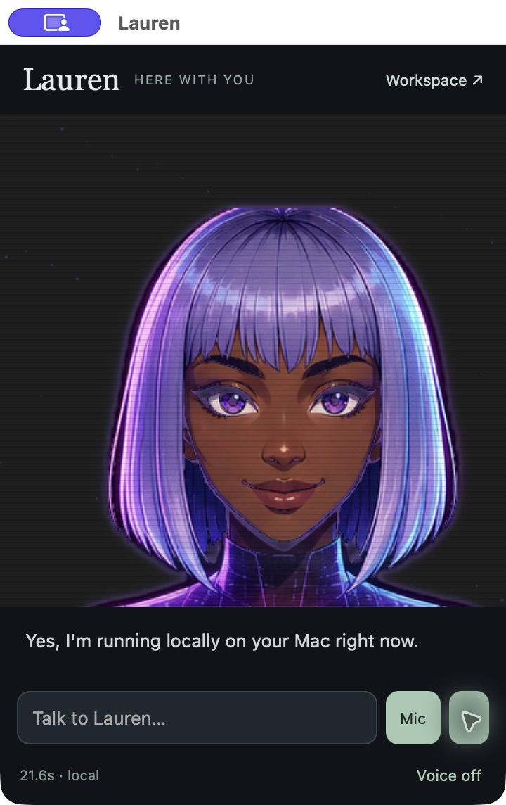

# Lauren Local



A personal AI companion that lives in a small, movable Mac window. Her animated face, conversations, memory, task queue, and model inference run on your laptop. LM Studio serves the model behind the scenes; Lauren has her own application and workspace.

Built by BJ Parker while studying for a Bachelor of Science in Artificial Intelligence at UNC Charlotte. This project explores the engineering around a local model: tool execution, persistence, speech, scheduling, user interface, and measurement.

## What runs today

- A native macOS menu bar app with a resizable, floating companion window and the original Lauren face.
- Local conversation through LM Studio's loopback API, with no paid cloud AI fallback.
- Persistent conversations and approved memory notes, plus SQLite lists, jobs, and measured run history.
- A bounded tool loop that can read saved lists, create lists, research public webpages, and schedule one-time tasks.
- Background jobs with explicit offline/online settings, saved reports, cancellation of queued work, and retry after failures.
- A separate workspace for reviewing results, switching installed models, and inspecting timings.
- Local Kokoro speech output, muted initially. No surprise alternate voice if synthesis fails.
- Push-to-talk transcription in the native companion using Apple's on-device English recognizer. If on-device recognition is unavailable, typing remains available and cloud speech is not used.

This is a working prototype. It is not an unrestricted computer agent. Its tools cannot send messages, publish, spend money, delete files, or execute shell commands. The model switcher invokes only fixed LM Studio CLI commands for the three supported model IDs.

## Quick start

Requirements: Apple Silicon Mac, LM Studio with a downloaded model, Node.js 24 or newer. The native wrapper also requires Xcode Command Line Tools.

1. Enable LM Studio's local server on **port 5321**. Keep it bound to `127.0.0.1`.
2. Download or select `qwen/qwen3.5-9b` (default). The workspace also supports `qwen/qwen3.8-27b` and `google/gemma-4-e2b` when installed.
3. Run:

```sh
npm start
```

Open `http://127.0.0.1:4327/companion.html` for the compact view or `http://127.0.0.1:4327/tasks.html` for tasks. The original full-screen face and camera prototype is available at `/`.

To build the native Mac app:

```sh
npm run build:mac
open Lauren.app
```

Keep `Lauren.app` in the project folder beside `src/` and `scripts/`. It starts the local server. Closing the window hides it; the menu bar keeps the app alive. **Quit Lauren** stops the server if the app started it. If another server was already running, the app reuses it.

The app is signed ad hoc for local development. This is not a notarized distribution build. Speech permission prompts appear only when you tap Mic; microphone capture is time-limited, and the transcript stays in the input box for review before you send it.

## Choosing a model on a 24 GB Mac

The initial development machine is an M4 MacBook Air with 24 GB unified memory. Its 4-bit Qwen3.8 27B occupies about 15 GiB when loaded with an 8K context and one inference slot. It can work, but leaves limited memory for other apps and speech. A real two-step list-save request took **78.1 seconds** during development. This is a single end-to-end measurement, not a formal throughput benchmark.

The equivalent two-step request took **21.2 seconds** with Qwen3.5 9B. The default is the already-installed 4-bit Qwen3.5 9B for everyday interaction. Choose 27B in the workspace when you prefer the larger model. Switching unloads Lauren's previous model and loads the chosen one with an 8K context and one slot. Current timings are visible in the workspace. See [validation](docs/VALIDATION.md) for what was actually tested.

## Local voice setup

The existing development machine reuses its installed Kokoro environment through an ignored `.local/voice-python` file. For a fresh machine:

```sh
python3.11 -m venv voice-service/.venv
voice-service/.venv/bin/pip install kokoro soundfile
brew install espeak-ng
```

Download/cache the `hexgrad/Kokoro-82M` model and chosen voice once with an internet connection before running Lauren in offline mode. The server starts the voice process with `HF_HUB_OFFLINE=1` and `TRANSFORMERS_OFFLINE=1`; missing assets produce a visible text-only state. No cloud TTS or browser voice fallback is used. Turn **Voice on** in the companion after previewing the voice. The default is Kokoro `af_heart`; it is a different voice from the previous cloud version.

## Research and background work

Offline is the default. Enable web access per task or turn it on for chat in the workspace. Inference stays local, but search queries and page requests necessarily go to the websites being researched. Do not enable web research for prompts containing information you do not want included in searches.

Search uses DuckDuckGo's HTML interface; it can be rate limited or challenged. A clearly labeled Wikipedia-only fallback is available. A supplied source URL can be read directly. This is basic research support, not exhaustive coverage of news or scholarly literature. Retrieved pages are untrusted evidence and cannot expand the tool set.

Jobs run only while the Mac is awake and the server is running. Missed queued tasks run on return. A task interrupted mid-run is marked **interrupted** for review and explicit retry, preventing silent replays of partially completed work. Closing the companion window keeps the app running; shutting down or sleeping the Mac stops computation. No login item, system daemon, or sleep-prevention setting is installed automatically.

## Development

```sh
npm run check
npm test
```

The JavaScript core uses Node built-ins and has no npm runtime dependencies. The full-screen camera prototype uses self-hosted MediaPipe assets; run `bash scripts/setup-vision.sh` once to download them on a fresh clone. They are already installed on the development machine and are excluded from Git. See [third-party notices](THIRD_PARTY_NOTICES.md). Models and voice weights are separate downloads governed by their own licenses.

- [Architecture and data boundaries](docs/ARCHITECTURE.md)
- [Validation and limitations](docs/VALIDATION.md)
- [Portfolio and next milestones](docs/PORTFOLIO.md)

Personal conversations, memory, SQLite databases, logs, generated media, local configuration, and application binaries are ignored by Git. Never add `data/` or `.local/` to a public repository.
