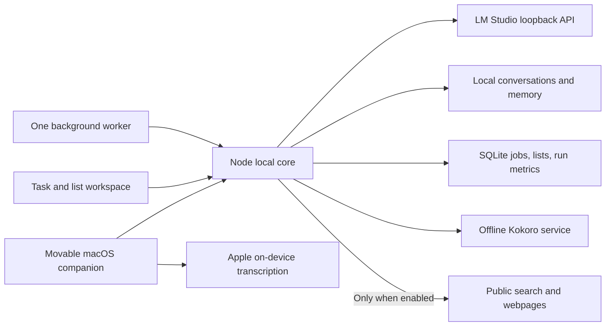

# Architecture

## Responsibilities

The native AppKit/WKWebView shell owns the movable window, menu bar lifecycle, and explicit microphone capture. HTML clients own Lauren's animation and result presentation. Node owns API validation, history, memory, local model requests, and tool execution. LM Studio owns model loading and inference. Model weights do not contain Lauren's live memory; memory is supplied as context.

`src/local-core.js` contains the model adapter, task scheduler, research tools, SQLite storage, and bounded agent loop. `src/server.js` integrates it with the existing face/camera prototype and local speech service. The older media/device/action scaffolding remains experimental; it is not exposed as an autonomous model tool.

## State and recovery

Lists, jobs, and run metrics live in `data/lauren.sqlite`, using WAL mode. Conversations, approved memory, device state, and errors remain in JSON files with serialized atomic writes. Jobs use queued/running/completed/failed/interrupted/cancelled states. Startup changes running jobs to interrupted; the user decides whether to retry. Each task is one-shot, and background models cannot recursively schedule tasks. One model request chain runs at a time; interactive callers get a visible busy response rather than competing for memory.

## Boundaries

- The assistant HTTP server binds only to loopback. Host and Origin checks reject foreign browser requests and DNS-rebinding Host values.
- The model endpoint must use local HTTP. No OpenAI or ElevenLabs runtime client remains.
- Model tools are an explicit allowlist; network tools are absent and rejected server-side for offline runs.
- Public page fetches validate protocols, ports, credentials, redirects, and resolved IP ranges. They cap response sizes, durations, and extracted text. This is not a hardened browser sandbox or a formal SSRF guarantee; DNS resolution and HTTP connection are separate operations.
- The model receives webpage text as untrusted tool data. Prompt instructions are defense in depth; actual authority comes from the limited tool implementations.
- Tool loops stop after seven model rounds or ten tool calls. Each model request has a four-minute timeout. A token-limited answer is treated as incomplete, not successful.
- Tool results carry IDs and receipts. Chat text does not itself constitute execution.
- The app keeps personal files outside Git tracking. A public repository contains source and art, not the personal runtime directory.

## Why keep LM Studio?

LM Studio is the model-serving layer, not Lauren's identity or UI. The installed MLX models already work on this Mac, and the API supports tool calls. A future Ollama or llama.cpp adapter can use the same application boundaries; a migration is only useful after measuring a concrete benefit. LM Studio also documents headless operation through llmster: https://lmstudio.ai/docs/developer/core/headless.
